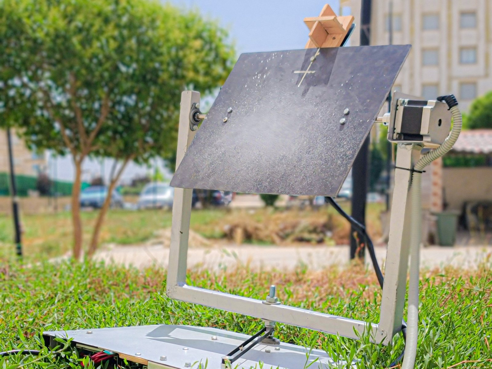
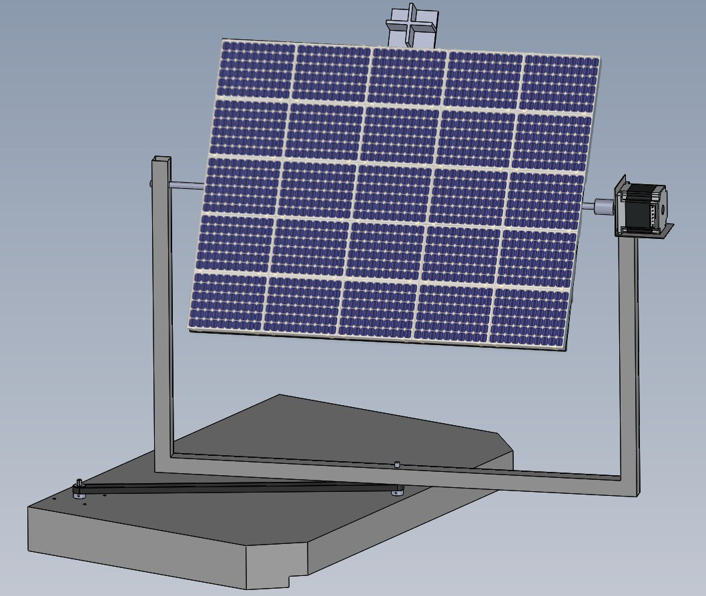
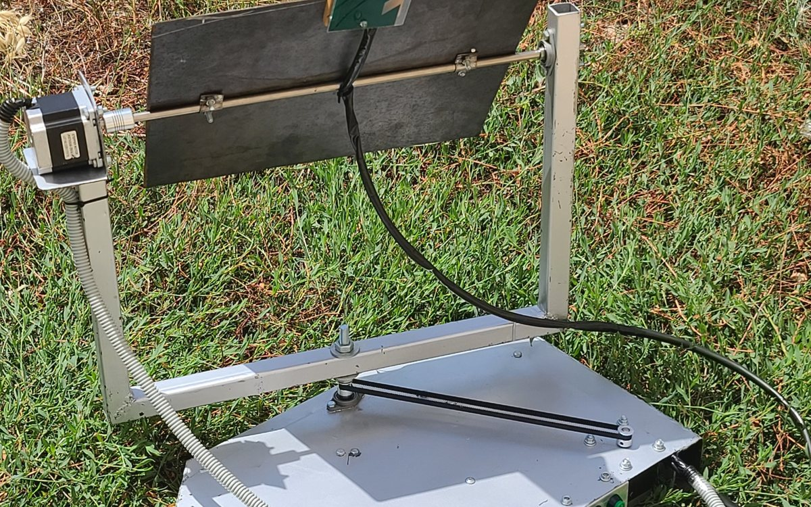
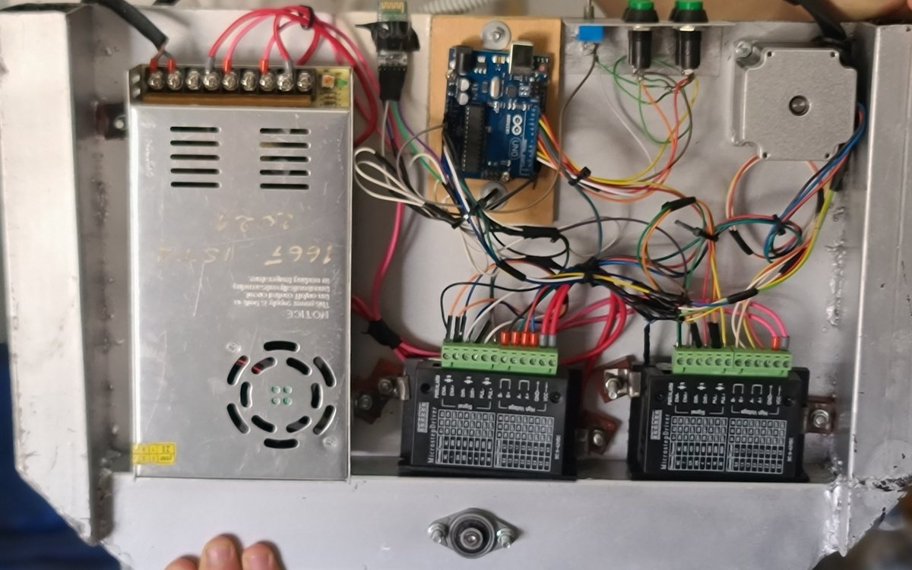

# Two-axis solar tracker

A solar tracker I designed and built. It turns a panel on two axes, azimuth and elevation, to keep it facing the sun. It is controlled by an Arduino Uno with four light sensors and two stepper motors.

## How it works

Four light-dependent resistors (LDRs) sit in the four corners of a cross-shaped shade on top of the panel. When the sun moves, part of the cross casts a shadow on one side, and that side's sensors read less light.

In automatic mode, the Arduino reads the four sensors (A0 to A3) every 0.5 s and splits them into pairs in two ways:

- (A0 + A1) against (A2 + A3) → motor 1,
- (A0 + A3) against (A1 + A2) → motor 2.

If a difference passes the threshold (30 on the 0–1023 analog scale), the matching motor steps in the right direction. It keeps stepping until the four sensors read about the same light.

A switch selects manual mode. In manual mode, four push buttons, or a phone sending `1` to `4` over a Bluetooth serial module, move each axis in either direction.

## Hardware

| Part | Role |
|---|---|
| Arduino Uno | Reads the sensors and buttons, sends step and direction signals |
| 4 × LDR | Light sensing behind the cross-shaped shade |
| 2 × NEMA 23 stepper motor | Elevation axis (direct drive) and azimuth axis (belt drive) |
| 2 × TB6600 driver | Power stage for each stepper |
| Bluetooth serial module | Manual control from a phone |
| Push buttons and mode switch | Manual control on the box |
| Ball bearings, belt and pulleys | Smooth rotation of both axes |

The structure was modelled in SolidWorks before it was built.

| SolidWorks model | Azimuth belt drive | Control box |
|---|---|---|
|  |  |  |

## Code

`solar_tracker.ino` is the original program from the project.

| Pin | Use |
|---|---|
| A0–A3 | The four LDRs |
| 5 | Mode switch (automatic / manual) |
| 6, 7 | Manual buttons, axis 1, each direction |
| 8, 9 | Manual buttons, axis 2, each direction |
| 10, 11 | Axis 1 step and direction |
| 12, 13 | Axis 2 step and direction |

To open it in the Arduino IDE, put the file in a folder named `solar_tracker`.

## Author

Mohamed Rayan Aissat, [portfolio](https://rayanaissat22-droid.github.io) · [LinkedIn](https://www.linkedin.com/in/mohamed-rayan-aissat-56880b337)
